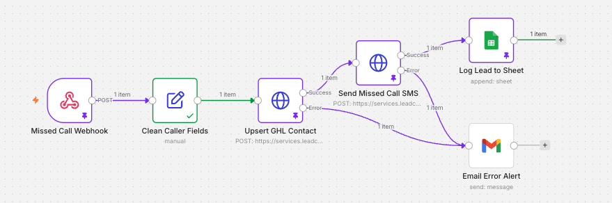

# Missed Call → CRM Automation

Tradies lose jobs every time they miss a call — the customer just rings the next business. This n8n workflow responds to every missed call instantly: it creates or updates the caller in the CRM, texts them back, and logs the lead.

## How it works

1. **Webhook** — GoHighLevel fires a webhook to n8n when a call is missed.
2. **Clean caller fields** — normalises the data (Australian numbers to E.164, e.g. `0412…` → `+61412…`; blank names become "New Caller").
3. **Upsert GHL contact** — creates or updates the contact via the GoHighLevel REST API, tagged `missed-call`.
4. **Send SMS** — sends a text-back to the caller through the GoHighLevel Conversations API.
5. **Log to Google Sheets** — appends the lead with timestamp, contact ID and SMS status.
6. **Error alert** — if either API call fails, an email alert is sent with the error details.

## Tools

n8n · GoHighLevel API v2 · REST APIs · Webhooks · JSON · Google Sheets · Gmail

## Security

- API token stored as an n8n credential (Header Auth), never in the workflow file.
- GoHighLevel Private Integration scoped to the minimum permissions needed (contacts, conversations/messages).
- Location ID, sheet ID and email replaced with placeholders in the published file.

## What I debugged

- **403 "token does not have access to this location"**: the Location ID didn't match the token's sub-account. Fixed by taking the ID straight from the sub-account URL.
- **"Credentials not found"**: one HTTP node still pointed at an unused OAuth credential. Re-pointed both nodes at the Header Auth credential.
- **Silent SMS failure (Twilio error 21661)**: the API returned success, but the sending number was a landline that can't send SMS. The workflow logic is correct; the fix is an SMS-capable mobile number.

## Next version

- Check SMS delivery status and alert on carrier failures, not just API errors.
- Add an AI step that reads the caller's reply and qualifies the job.
- Swap Google Sheets for a job management system such as ServiceM8.

## Setup

1. Import `workflow.json` into n8n.
2. Create a Header Auth credential: `Authorization` = `Bearer <your GoHighLevel Private Integration token>`.
3. Replace `YOUR_LOCATION_ID`, `YOUR_SHEET_ID` and `YOUR_EMAIL@example.com` with your own values.
4. Point a GoHighLevel missed-call workflow at the webhook URL.
